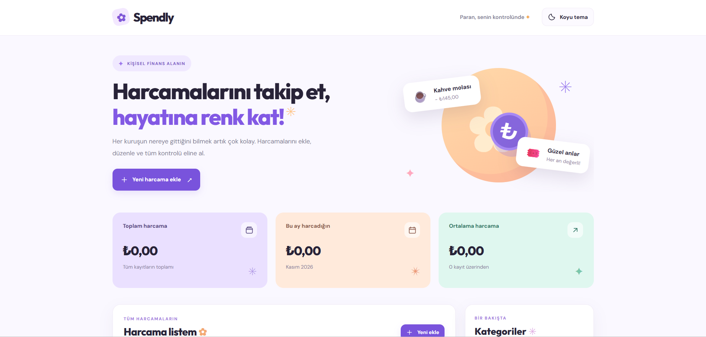

# 🌸 Spendly — Kişisel Harcama Takip Uygulaması

React ve Vite ile geliştirilmiş, renkli, modern ve mobil uyumlu bir kişisel harcama takip web uygulamasıdır.

🔗 **Canlı Demo:** [dazzling-faun-4746a5.netlify.app](https://dazzling-faun-4746a5.netlify.app/)

Spendly, kullanıcıların günlük harcamalarını kaydetmesini, düzenlemesini, kategorilere ayırmasını ve harcama alışkanlıklarını takip etmesini amaçlamaktadır.

## ✨ Özellikler

- ✅ Harcama ekleme (ad, tutar, tarih, kategori, isteğe bağlı not)
- ✅ Harcama düzenleme ve onaylı silme
- ✅ Metne göre arama
- ✅ Kategori ve aya göre filtreleme
- ✅ Açık / koyu tema
- ✅ Toplam harcama, bu ayın harcaması, ortalama harcama
- ✅ Kategori bazında harcama özeti
- ✅ LocalStorage ile tarayıcıda kalıcı kayıt
- ✅ Mobil, tablet ve masaüstüne uyumlu tasarım

## 🛠️ Kullanılan Teknolojiler

- **React 19:** Kullanıcı arayüzünün geliştirilmesi
- **Vite 7:** Proje kurulumu ve geliştirme ortamı
- **JavaScript (JSX):** Uygulama fonksiyonlarının geliştirilmesi
- **HTML5:** Web sayfası yapısı
- **CSS3:** Tasarım ve responsive düzen
- **LocalStorage API:** Harcama bilgilerinin tarayıcıda saklanması
- **Visual Studio Code:** Kod geliştirme ortamı
- **ChatGPT:** Yapay zeka destekli proje geliştirme

## 🤖 Yapay Zeka Kullanımı

Spendly projesinin geliştirilmesinde yapay zeka asistanı olarak **ChatGPT** kullanılmıştır.

Yapay zekadan aşağıdaki aşamalarda destek alınmıştır:

### 1. Proje Planlama

Uygulamanın amacı, hedef kullanıcıları, temel özellikleri ve kullanılacak teknolojiler ChatGPT desteğiyle belirlenmiştir.

### 2. Kod Geliştirme

React bileşenlerinin oluşturulması ve aşağıdaki fonksiyonların geliştirilmesinde yapay zekadan yararlanılmıştır:

- Harcama ekleme, düzenleme ve silme
- Harcama arama ve filtreleme
- Toplam ve aylık harcama hesaplama
- LocalStorage ile veri saklama
- Açık ve koyu tema yönetimi

### 3. Kullanıcı Arayüzü Tasarımı

Renkli, modern ve mobil uyumlu bir kullanıcı arayüzü hazırlanmasında ChatGPT'den tasarım ve stil önerileri alınmıştır.

### 4. Hata Ayıklama

Geliştirme sırasında karşılaşılan `React is not defined` hatası ChatGPT yardımıyla analiz edilmiş ve gerekli React import işlemi gerçekleştirilerek çözülmüştür.

### 5. Dokümantasyon

README dosyasının hazırlanması, kurulum komutlarının açıklanması ve proje teslim aşamalarının planlanmasında yapay zekadan destek alınmıştır.

Yapay zeka tarafından oluşturulan kodlar Visual Studio Code ortamına aktarılmış, uygulama yerel geliştirme sunucusunda çalıştırılmış ve karşılaşılan hatalar giderilmiştir.

## 🚀 Kurulum

Bilgisayarınızda **Node.js (güncel LTS)** ve npm kurulu olmalıdır.

Proje klasöründe terminal açarak aşağıdaki komutları çalıştırın:

```bash
npm install
npm run dev
```

Terminalde gösterilen yerel adresi (genellikle `http://localhost:5173/`) tarayıcıda açın.

## 📦 Üretim Sürümü

```bash
npm run build
npm run preview
```

Üretim dosyaları `dist/` klasöründe oluşturulur.

## 📁 GitHub'a Yükleme

1. GitHub'da public (herkese açık) yeni bir depo oluşturun.
2. Proje klasöründe aşağıdaki komutları çalıştırın:

```bash
git init
git add .
git commit -m "Spendly ilk sürüm"
git branch -M main
git remote add origin https://github.com/dizedurgay/Spendly.git
git push -u origin main
```

## 🌐 Vercel ile Yayınlama

1. https://vercel.com adresine GitHub hesabınızla giriş yapın.
2. **Add New → Project** seçeneğinden GitHub deponuzu seçin.
3. Proje yapılandırmasını aşağıdaki şekilde ayarlayın:
   - Framework: Vite
   - Build Command: `npm run build`
   - Output Directory: `dist`
4. **Deploy** butonuna basın.
5. Oluşturulan canlı uygulama bağlantısını proje teslim formunda paylaşın.

## 📊 Veri Modeli

Her harcama kaydı aşağıdaki yapıdadır:

```json
{
  "id": "benzersiz-kimlik",
  "title": "Kahve",
  "amount": 145,
  "category": "yeme",
  "date": "2026-11-15",
  "note": "Arkadaşlarla"
}
```

Veriler sunucuya gönderilmez; yalnızca uygulamanın kullanıldığı tarayıcıda LocalStorage üzerinden saklanır.

Başka cihazlarda veya farklı tarayıcılarda kayıtlar otomatik olarak görünmez. Tarayıcı verileri temizlenirse kayıtlar kaybolabilir.

## 📸 Ekran Görüntüsü



## ⚠️ Bilinen Sınırlamalar

- Kullanıcı hesabı ve giriş sistemi bulunmamaktadır.
- Sunucu ve çevrim içi veri senkronizasyonu içermez.
- Harcama bilgileri yalnızca kullanılan tarayıcıda saklanır.
- Tarayıcı verilerinin temizlenmesi kayıtların silinmesine neden olabilir.
- Uygulama gerçek bankacılık işlemleri gerçekleştirmez; harcamalar kullanıcı tarafından manuel olarak eklenir.

## 📋 Proje Teslim Kontrol Listesi

- [x] React ve Vite ile proje oluşturuldu.
- [x] Yapay zeka aracı olarak ChatGPT kullanıldı.
- [x] Proje planlaması yapıldı.
- [x] HTML, CSS ve JavaScript kullanıldı.
- [x] Harcama takip uygulaması geliştirildi.
- [x] LocalStorage ile veri saklama özelliği eklendi.
- [x] Uygulama yerel geliştirme ortamında çalıştırıldı.
- [x] README ve yapay zeka kullanım açıklamaları hazırlandı.
- [ ] Tüm uygulama fonksiyonları test edildi.
- [ ] En az bir proje ekran görüntüsü eklendi.
- [ ] Proje GitHub'da public depoya yüklendi.
- [ ] Proje Vercel üzerinden yayınlandı.
- [ ] GitHub ve canlı uygulama bağlantıları teslim edildi.

---

**Spendly — Yapay Zeka Destekli Web Geliştirme Projesi | 2026**
